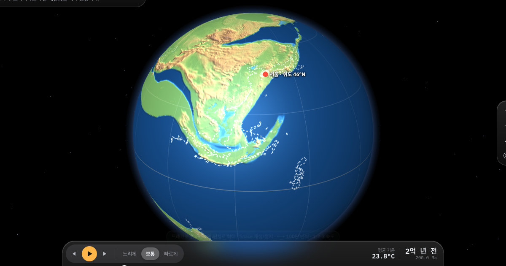

# Continental Time Machine · 지구 대륙 타임머신

**▶ Live: https://junhyeopsong.github.io/earth-time-machine/**

[English](#english) · [한국어](#한국어)



---

## English

An interactive 3D globe that shows how Earth's continents moved — from the supercontinent Pangaea 250 million years ago to 100 million years in the future — built on published plate-tectonic and paleo-elevation data.

### Features
- **Travel through time** — drag the timeline, play at three speeds, or jump straight to a geologic period (Triassic → Quaternary).
- **Real paleogeography** — 0.25° paleo-elevation maps (PaleoDEM) every 5 million years, with the coastlines and sea level of each age.
- **Plate motions** — every landmass moves with its plate in the PALEOMAP model; optional plate-boundary and present-day-coastline overlays.
- **Major events on the map** — the Chicxulub impact, the Siberian and Deccan Traps, the first dinosaurs, India hitting Asia and more, many with animated map effects.
- **The future** — Scotese's forecast plate motions to +100 million years, with a simple model of new mountains, basins, erosion and trenches where plates collide.
- **Track any place** — search 1,266 cities, or start from the city nearest to you (from your device location, or roughly from your time zone).
- **Global mean temperature** for each age, in °C or °F.
- **10 languages** — English, 한국어, 日本語, 简体中文, 繁體中文, Español, Français, Deutsch, Português, Русский. Follows your device language.

### Controls
| Action | Mouse / touch | Keyboard |
|---|---|---|
| Rotate the globe | Drag | Shift + ← → ↑ ↓ |
| Zoom | Scroll / pinch, double-click a spot | + / − |
| Play / pause | ▶ button | Space |
| Step 1 million years (stops at events) | ◀ ▶ buttons | ← → |
| Playback speed | Slow · Normal · Fast | 1 · 2 · 3 |

### Data sources
| Data | Source | License |
|---|---|---|
| Past terrain & coastlines | Scotese & Wright (2018), PALEOMAP PaleoDEMs — [Zenodo 5460860](https://zenodo.org/records/5460860) | CC BY 4.0 |
| Plate rotations & plate polygons | PALEOMAP PaleoAtlas for GPlates (Scotese) — [doi:10.5281/zenodo.10596609](https://doi.org/10.5281/zenodo.10596609), via [GPlates Web Service](https://gws.gplates.org) | CC BY 4.0 |
| Global mean temperature | PhanDA, Judd et al. (2024), *Science* — [doi:10.1126/science.adk3705](https://doi.org/10.1126/science.adk3705) ([GitHub](https://github.com/EJJudd/PhanDA)) | Cited research result |
| Cities | [Natural Earth](https://www.naturalearthdata.com) populated places | Public domain |
| 3D rendering | [three.js](https://threejs.org) r128 | MIT |

**Notes.** The future section follows Scotese's forecast; terrain changes from collisions and subduction are a rule-based estimate, not a physical simulation. Event descriptions and translations were written from general geology references — corrections are welcome.

### Feedback
Found a mistake, have an idea, or want an event added? Email **sapu0000@gmail.com** or [open an issue](https://github.com/JunhyeopSong/earth-time-machine/issues).

### Run locally
```bash
cd docs && python3 -m http.server 8000
```
Then open http://localhost:8000.

---

## 한국어

2억 5천만 년 전 초대륙 판게아부터 1억 년 뒤 미래까지, 대륙이 어떻게 움직여 왔고 움직일지를 3D 지구본에서 돌려보는 웹 시뮬레이터입니다. 실제 연구에 쓰이는 판 운동·고지형 데이터를 바탕으로 만들었습니다.

### 기능
- **시간 여행** — 타임라인을 끌거나, 세 가지 속도로 재생하거나, 지질시대(트라이아스기 ~ 제4기)로 바로 이동할 수 있습니다.
- **실제 고지리** — 500만 년 간격의 0.25° 고지형 지도(PaleoDEM)로 그 시대의 해안선과 해수면을 보여줍니다.
- **판 이동** — 모든 땅이 PALEOMAP 판 모델에 따라 자기 판과 함께 움직입니다. 판 조각 경계와 현재 해안선 윤곽을 겹쳐 볼 수 있습니다.
- **지도 위 주요 사건** — 칙술루브 소행성 충돌, 시베리아·데칸 트랩, 최초의 공룡, 인도-아시아 충돌 등. 상당수는 지도 위 애니메이션 효과가 있습니다.
- **미래 예측** — 1억 년 뒤까지 Scotese의 판 운동 예측을 따르고, 대륙이 부딪히는 곳의 산맥·분지·침식·해구를 단순한 모델로 계산했습니다.
- **위치 추적** — 1,266개 도시를 검색하거나, 기기 위치(또는 시간대)를 바탕으로 가장 가까운 도시에서 시작합니다.
- **지구 평균 기온** — 시대별 평균 기온을 °C 또는 °F로 보여줍니다.
- **10개 언어** — 한국어, English, 日本語, 简体中文, 繁體中文, Español, Français, Deutsch, Português, Русский. 기기 언어를 따릅니다.

### 조작법
| 동작 | 마우스 / 터치 | 키보드 |
|---|---|---|
| 지구 돌리기 | 드래그 | Shift + ← → ↑ ↓ |
| 확대·축소 | 휠 / 핀치, 원하는 곳 더블클릭 | + / − |
| 재생 / 정지 | ▶ 버튼 | Space |
| 100만 년씩 이동 (사건이 있으면 멈춤) | ◀ ▶ 버튼 | ← → |
| 재생 속도 | 느리게 · 보통 · 빠르게 | 1 · 2 · 3 |

### 데이터 출처
| 자료 | 출처 | 라이선스 |
|---|---|---|
| 과거 지형·해안선 | Scotese & Wright (2018), PALEOMAP PaleoDEMs — [Zenodo 5460860](https://zenodo.org/records/5460860) | CC BY 4.0 |
| 판 회전·판 다각형 | PALEOMAP PaleoAtlas for GPlates (Scotese) — [doi:10.5281/zenodo.10596609](https://doi.org/10.5281/zenodo.10596609), [GPlates Web Service](https://gws.gplates.org) 이용 | CC BY 4.0 |
| 지구 평균 기온 | PhanDA, Judd et al. (2024), *Science* — [doi:10.1126/science.adk3705](https://doi.org/10.1126/science.adk3705) ([GitHub](https://github.com/EJJudd/PhanDA)) | 논문 결과 인용 |
| 도시 | [Natural Earth](https://www.naturalearthdata.com) populated places | 퍼블릭 도메인 |
| 3D 렌더링 | [three.js](https://threejs.org) r128 | MIT |

**참고.** 미래 구간은 Scotese의 예측을 따르며, 충돌·섭입에 따른 지형 변화는 물리 시뮬레이션이 아니라 규칙에 따른 추정입니다. 사건 설명과 번역은 일반적인 지질학 자료를 바탕으로 작성했습니다. 틀린 부분을 알려주시면 고치겠습니다.

### 피드백
틀린 내용, 아이디어, 추가하고 싶은 사건이 있다면 **sapu0000@gmail.com** 으로 메일을 보내주시거나 [이슈](https://github.com/JunhyeopSong/earth-time-machine/issues)를 남겨주세요.

### 로컬에서 실행
```bash
cd docs && python3 -m http.server 8000
```
브라우저에서 http://localhost:8000 을 엽니다.
